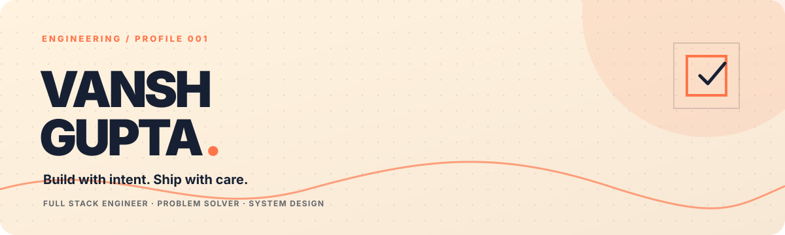
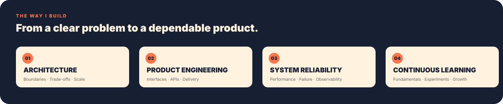
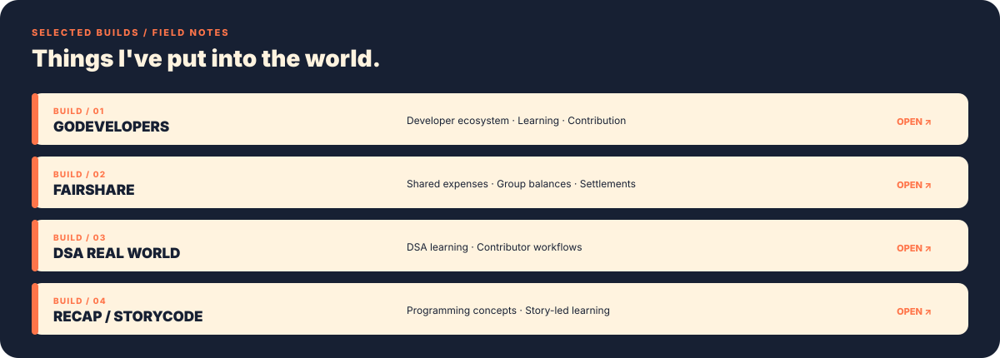

<h3>🚩 JAI SHREE RAM 🚩</h3>
<h2>Hi, I'm Vansh Gupta 👋</h2>

<strong>Full Stack Engineer · Problem Solver · System Design Enthusiast</strong>

  
  
  

---

## 01 / ABOUT THE BUILDER

I'm a **Full Stack Engineer** focused on building scalable, maintainable, reliable, and performance-driven systems. I enjoy working across the stack — from frontend interfaces and backend services to APIs, databases, cloud infrastructure, and distributed systems.

I like understanding the engineering behind a product: the boundaries between services, the trade-offs in architecture, the edge cases users never see, and the details that make software dependable.

## 02 / THE TOOLKIT

**LANGUAGES**

  
  
  
  

**FRONTEND**

  
  
  

**BACKEND & APIs**

  
  
  
  

**DATABASE & INFRASTRUCTURE**

  
  
  
  
  
  
  

## 03 / SELECTED MISSIONS

| Build | What it is | Link |
|---|---|---|
| **GoDevelopers** | Developer ecosystem for learning, collaboration and real-world contribution. | [Explore ↗](https://godevelopers.space/) |
| **FairShare** | Shared-expense application for group spending, balances and settlements. | [Explore ↗](https://fairshare.guptavansh5747.workers.dev/) |
| **DSA Real World** | DSA learning and contributor workflow experience. | [Explore ↗](https://dsa-real-world.lovable.app/) |
| **Recap / StoryCode** | Programming concepts explored through story-led learning. | [Explore ↗](https://recap.godevelopes.space/) |

## 04 / GITHUB FIELD STATS

  
  

## 05 / DEVELOPER THOUGHT

> Good engineering is not about writing more code. It's about understanding the problem, making sound decisions, and building something dependable.

  
  <h3>LET'S BUILD SOMETHING MEANINGFUL.</h3>
  
  
  
    
  
    
  BUILD WITH DISCIPLINE · LEARN WITH CURIOSITY · ENGINEER FOR THE LONG TERM

