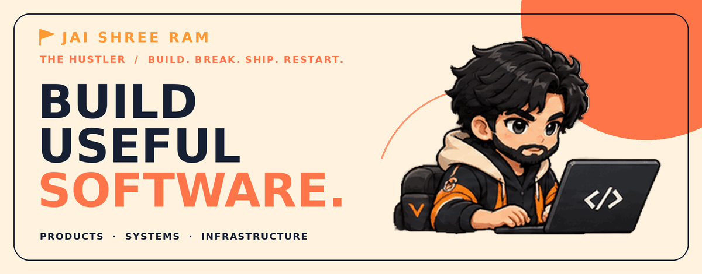
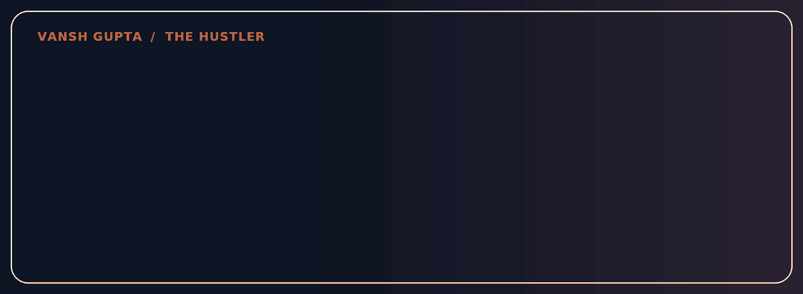

## About

I'm Vansh — a full stack engineer building products across frontend, backend and infrastructure. I enjoy turning real problems into reliable software, with thoughtful architecture and clean execution.

## Selected work

- **[GoDevelopers ↗](https://godevelopers.space/)** — Developer ecosystem for learning and real-world contribution.
- **[FairShare ↗](https://fairshare.guptavansh5747.workers.dev/)** — Shared expenses, balances and group settlements.
- **[DSA Real World ↗](https://dsa-real-world.lovable.app/)** — DSA learning and contributor workflows.
- **[Recap / StoryCode ↗](https://recap.godevelopes.space/)** — Programming concepts through stories.

## Stack

  

## GitHub

  
  

  <a href="https://aboutvansh.vercel.app"><b>Portfolio</b></a> ·
  <a href="https://www.linkedin.com/in/vansh-gupta-b220961b7/"><b>LinkedIn</b></a> ·
  <a href="mailto:vanshgupta7668@gmail.com"><b>Email</b></a>

