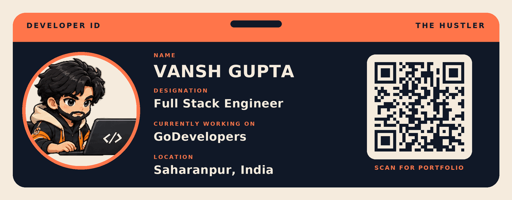

<picture>
  <source media="(max-width: 600px)" srcset="./assets/hero-mobile.png" />
  
</picture>

 

## About

  <picture>
    <source media="(max-width: 600px)" srcset="./assets/id-card-mobile.png" />
    
  </picture>

## Selected work

  <a href="https://godevelopers.space/">
    <picture>
      <source media="(max-width: 600px)" srcset="./assets/work-godevelopers-m.svg" />
      
    </picture>
  </a>
  <a href="https://fairshare.guptavansh5747.workers.dev/">
    <picture>
      <source media="(max-width: 600px)" srcset="./assets/work-fairshare-m.svg" />
      
    </picture>
  </a>
  <a href="https://dsa-real-world.lovable.app/">
    <picture>
      <source media="(max-width: 600px)" srcset="./assets/work-dsa-real-world-m.svg" />
      
    </picture>
  </a>
  <a href="https://recap.godevelopes.space/">
    <picture>
      <source media="(max-width: 600px)" srcset="./assets/work-recap-m.svg" />
      
    </picture>
  </a>

## Stack

  

## GitHub

  <picture>
    <source media="(max-width: 600px)" srcset="./profile/github-m.svg" />
    
  </picture>

  
  <a href="https://github.com/goyalvansh4">
    <picture>
      <source media="(max-width: 600px)" srcset="./assets/thought-m.svg" />
      
    </picture>
  </a>

